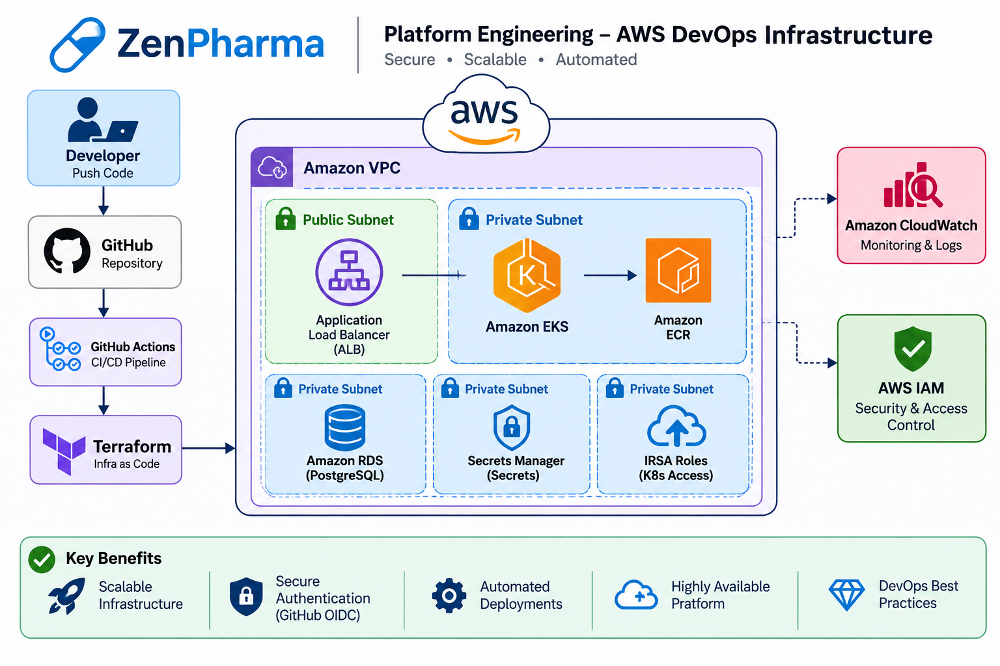

# ZenPharma Platform Engineering – AWS DevOps Infrastructure

**Author:** Abdirahman Muse  
**Organization:** MuseCloudOps-Labs  
**Project:** ZenPharma Cloud-Native Platform Engineering

## Architecture Overview



## Overview

ZenPharma is an AWS Platform Engineering and DevOps project focused on designing, building, and managing scalable cloud infrastructure using Infrastructure as Code (IaC).

The project demonstrates practical implementation of modular Terraform infrastructure, AWS networking, identity and access management, secure authentication, and cloud-native infrastructure foundations.

## Technology Stack

- **Terraform** – Infrastructure as Code
- **AWS IAM** – Identity and Access Management
- **Amazon VPC** – Cloud Networking
- **Amazon EKS** – Kubernetes Container Orchestration
- **Amazon ECR** – Container Image Registry
- **Amazon RDS** – Managed Relational Database
- **AWS Secrets Manager** – Secrets Management
- **GitHub Actions** – CI/CD Automation
- **GitHub OIDC** – Secure AWS Authentication

## Project Structure

```text
infra/
├── envs/
│   └── dev/
│       ├── main.tf
│       ├── variables.tf
│       └── outputs.tf
├── modules/
│   ├── vpc/
│   ├── iam/
│   ├── eks/
│   ├── ecr/
│   ├── rds/
│   └── secrets-manager/
├── images/
│   ├── aws_architecture.png
│   └── ZenPharma AWS DevOps Architecture.png
├── .gitignore
└── README.md
```

## Implemented Modules

| Module          | Status      |
| --------------- | ----------- |
| VPC             | Implemented |
| IAM             | Implemented |
| GitHub OIDC     | Implemented |
| IRSA Roles      | Implemented |
| EKS             | Implemented |
| ECR             | Implemented |
| RDS             | Implemented |
| Secrets Manager | Implemented |
| Security Groups | Implemented |

## Security Practices

- IAM least-privilege permissions
- GitHub Actions OIDC authentication
- No hardcoded AWS credentials
- Terraform state protection
- Infrastructure formatting and validation
- Secure secrets management

## Project Goals

- Build reusable and modular Terraform infrastructure.
- Implement secure AWS identity and access management.
- Establish secure CI/CD authentication with GitHub OIDC.
- Practise Kubernetes, GitOps, and DevSecOps workflows.
- Develop practical Platform Engineering and Cloud DevOps skills.

## Author

**Abdirahman Muse**

- GitHub: [@Abdirahman455](https://github.com/Abdirahman455)
- Organization: [MuseCloudOps-Labs](https://github.com/MuseCloudOps-Labs)
